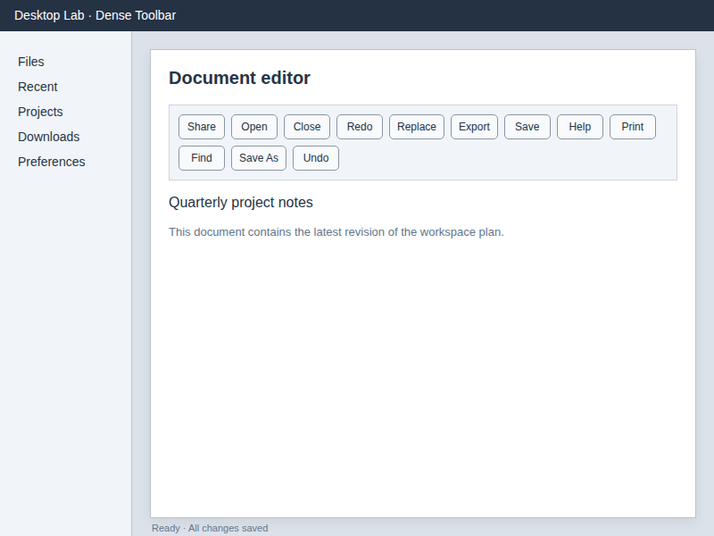
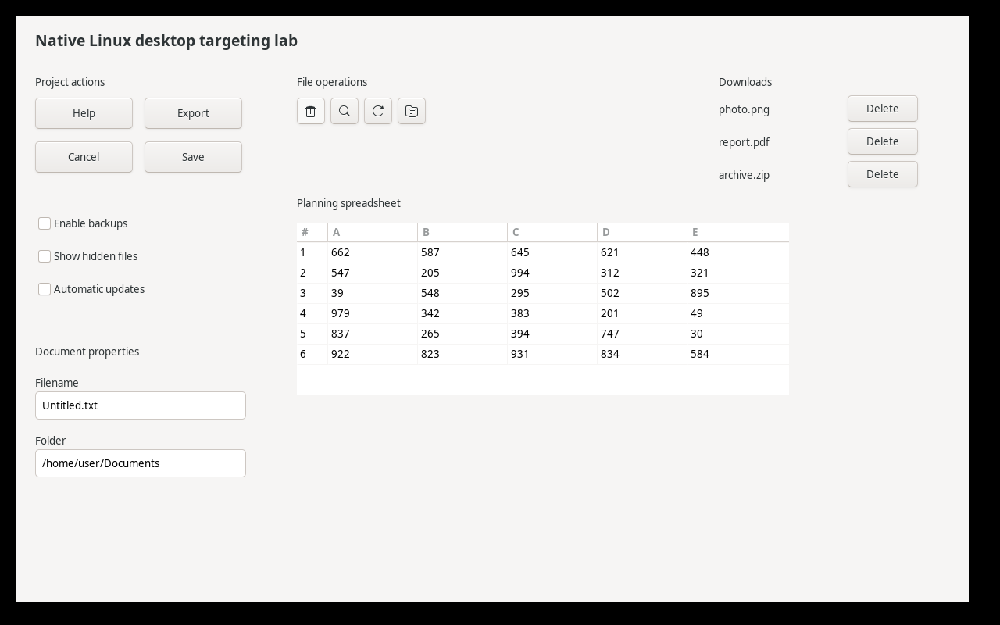

# Desktop Grounding Bench

A small, experimental benchmark for asking vision-capable models to locate controls in Linux desktop screenshots through Ollama. Developed while exploring **unshipped visual desktop control in omnideck**.

This is a targeting benchmark, not a general computer-use leaderboard. The default runner never moves your mouse. It sends a screenshot and one target description to a model, validates the response, and scores the resulting point against recorded target bounds.

## Quick start

Python 3.10+; the screenshot replay uses only the Python standard library. Run a local Ollama service with the chosen vision-capable model available. Cloud model tags require an appropriately authenticated Ollama service and can incur charges. The models below are historical identifiers; availability can change.

```sh
git clone https://github.com/lefoulkrod/desktop-grounding-bench.git
cd desktop-grounding-bench
python3 bench.py --validate
python3 -m unittest discover -s tests -v

# One positive fixture for a small connectivity check; no absent cases.
python3 bench.py --model deepseek-v4.1-flash:cloud --repeats 1 --limit 1

# Full run: 60 positive + 6 absent targets, repeated three times = 198 requests.
python3 bench.py --model deepseek-v4.1-flash:cloud --repeats 3

# Repeat --model to compare models. Order rotates between repetitions.
python3 bench.py --model deepseek-v4.1-flash:cloud --model kimi-k3:cloud --repeats 3
```

Use `--host http://localhost:11434` or `OLLAMA_HOST` to select your Ollama service, `--timeout` for the request timeout, and `--output` for a new output directory. Each attempt is saved to JSONL immediately, with a summary and run metadata beside it. Existing output directories are rejected so prior runs are preserved. The endpoint is an Ollama `/api/chat` endpoint, not an OpenAI-compatible endpoint.

The frozen PNGs are the images sent to the model. Target boxes and fixture IDs are **not** sent. There are no numbered overlays in this runner. The six absent-target tests reuse the first six native fixtures with the target `ZEBRA-ABSENT-9042`.

## What is tested

| Split | Unique images | Examples |
| --- | ---: | --- |
| Development | 24 | Save vs Save As, trash icon, Delete on archive.zip, Filename field, cell C4 |
| Held-out during prompt development | 24 | Export, Replace, search icon, Delete on report.pdf, Folder field, cell D3 |
| Native GTK | 12 | Buttons, small icons, repeated labels, entries, checkboxes, table cells |

Development sizes: 800×600, 1024×768, 1280×720, 1920×1080. Held-out sizes: 960×640, 1366×768, 1600×900, 1920×1200. Native GTK: two layouts at 1280×800. “Held-out” describes the original experiment; these public fixtures are no longer a private evaluation set.





## Prompt and scoring

`grounding.py` preserves the experimental implementation's prompt and validator:

```text
<Target description>
Point to the visual center of that control. Use native image coordinates normalized to 0–1000 for x and y. Return only {"x": ..., "y": ...}. Do not convert into pixels or do resolution arithmetic. If absent return {"found":false}.
```

Requests use `think: false`, temperature 0, and `num_predict: 4096`. The validator accepts a JSON object, optionally enclosed in a single Markdown code fence, with exactly `x` and `y`; coordinates must be finite numbers in 0–1000. It also accepts the implementation's absent-target sentinel. Pixels are `round(x * (width - 1) / 1000)` and likewise for y. A hit lies inside the target rectangle; the right and bottom edges are exclusive. This scores an actionable point, not a precise center prediction.

The extracted validator intentionally retains the original behavior. In particular, its Python dictionary comparison also treats `{"found":0}` as the false sentinel. None of the published outcomes depend on that edge case. A future stricter sentinel check should be versioned rather than silently changing historical scoring.

Request timing includes HTTP, network, and provider overhead. It is neither pure inference time nor complete desktop-action time. Request failures, output-contract failures, target misses, and false positives are recorded separately.

## Historical results

These are **saved development results**, not new measurements from the standalone runner. The original production-tool replay substituted screenshot capture and pointer injection while invoking omnideck's `visual_click`, provider adapter, and validator. Each model saw 60 unique positive fixtures three times and 18 absent-target attempts.

| Model | Accepted correct points | Median provider request | Absent targets |
| --- | ---: | ---: | ---: |
| `deepseek-v4.1-flash:cloud` | 180/180 | 0.378 s | 18/18 |
| `kimi-k3:cloud` | 177/180 | 0.891 s | 18/18 |
| `glm-5.3-flash:cloud` | 0/180 under the strict contract | 1.416 s | 0/18 |

GLM's responses failed the output contract, including explanatory text and coordinate-format issues. This is an integration result, not a claim that GLM cannot visually locate controls. An earlier, more permissive harness recorded different results; its data are preserved under `results/historical/earlier-*` and must not be pooled with the strict replay.

A separate original live GTK test recorded actual press/release, hover, and drag events. DeepSeek and Kimi each passed 12/12 checks (three repetitions of four cases). Median complete-tool times were 0.850/1.412 s for click, 0.813/1.337 s for hover, and 1.510/2.432 s for drag, respectively. Those timings include the original tool's screenshot/input/observation work.

Repetitions are not additional unique interfaces. These small synthetic cohorts do not establish reliability across arbitrary applications. Cloud timings vary by service load. A correctly formatted point can still target the wrong control; application-state verification remains necessary.

## Optional live native input check

This **new standalone adaptation** creates its own Xvfb display and GTK application. It records actual mouse events for click, hover, drag, and an absent target, and checks that the left button is released. It does not use your existing desktop display or omnideck container. Accessibility is disabled in this isolated visual-only fixture. This is not an accessibility benchmark.

On Debian/Ubuntu, the optional dependencies are:

```sh
sudo apt-get install xvfb python3-gi gir1.2-gtk-3.0 libxtst6
# Verify harness input/scoring using known bounds; no model calls or accuracy claim.
python3 live_gtk.py --oracle --repeats 3
# Use a real model (five requests per repetition: drag grounds two targets).
python3 live_gtk.py --model deepseek-v4.1-flash:cloud --repeats 3
```

Use system Python so it can find PyGObject. Targeting uses a fresh screenshot for each action; both drag endpoints share one screenshot and are requested concurrently. The standalone GTK rendering/event loop differs from the original live harness, so new timings are not directly comparable to historical complete-tool timings. Results, event traces, and a screenshot are saved under `runs/`.

## Provenance and reproducibility

- `fixtures/manifest.json`: original frozen images, target boxes, split labels, and SHA-256 hashes. Local source-path and overlay metadata were removed; image bytes are unchanged.
- `grounding.py`: copied experimental prompt and validator.
- `results/historical/`: original strict replay, original live-test results, and the explicitly separate earlier native comparison.
- `archive/`: original exploratory generators and production replay/live scripts, saved as text for inspection. They are **not portable entry points**; some assume an omnideck checkout, container paths, installed Chrome, or original neighboring files. Do not run them on an active desktop. Use `bench.py` or `live_gtk.py` instead.
- `PROVENANCE.json`: snapshot hashes tying the exported artifacts to this package. The original experiment came from a development worktree with uncommitted changes; a Git commit alone would not describe that state.

The extraction was checked offline against every saved strict-replay response: all published hit/miss outcomes reproduce. The live adaptation passed 12/12 oracle input checks; these validate the harness, not a model. No new model comparison was run while packaging this repository.

The standalone runner talks directly to Ollama and does **not** reproduce omnideck's provider adapter, retries, observation logic, or complete action latency. Use the archived scripts as methodology evidence for the published experiment, not a claim of turnkey reproduction of the whole development container.

Apache-2.0; see `LICENSE` and `NOTICE`.
